<h1 align="center">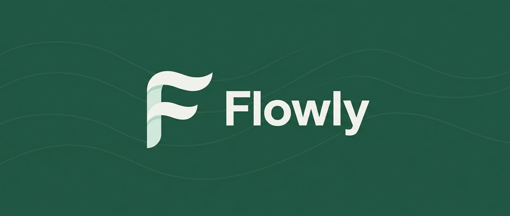</h1>

<p align="center">
  <b>A monthly budget that knows what you can actually spend today, and tells nobody else.</b>
</p>

<p align="center">
  
</p>

<p align="center">
  No account. No sync. No ads. Your money stays on your computer.
</p>

## The one number that matters

Income minus bills minus goals is what you really have to spend. Log a coffee and it updates. Flowly also looks ahead through your bills, and if rent is about to overdraw your checking account, it tells you how much to move, from where, and by when, counting business days and bank holidays.

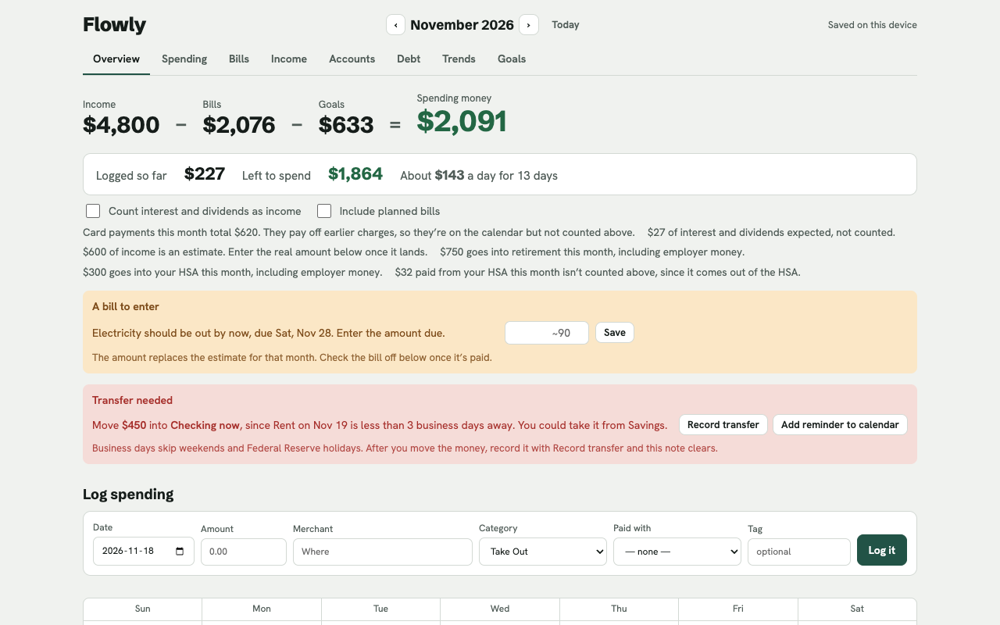

## See the whole month

Every paycheck, bill and card payment on one calendar, with the balance after each one. Bills that change every month, like electricity, start as an estimate; enter the real amount when the bill arrives.

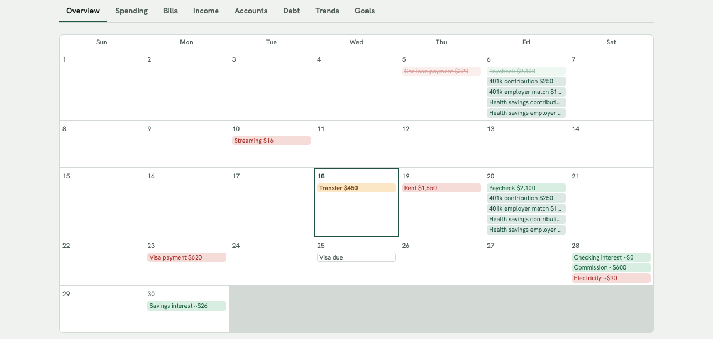

## And everything around it

<table>
  <tr>
    <td width="50%"><b>Spending</b><br>Quick logging that remembers merchants, bank CSV import, category rules, tags, budgets per category.<br><br>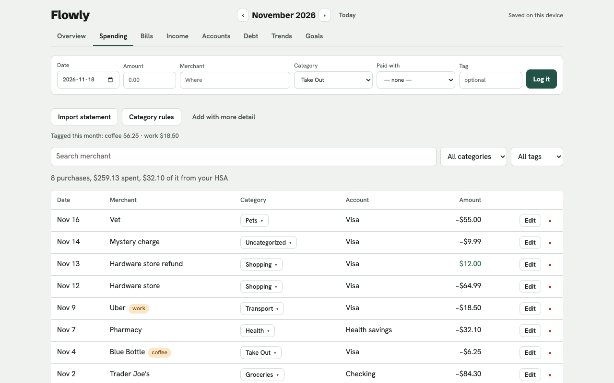</td>
    <td width="50%"><b>Accounts</b><br>Checking, savings, cards, loans, investments, retirement and HSA, with transfers between them and net worth over time.<br><br>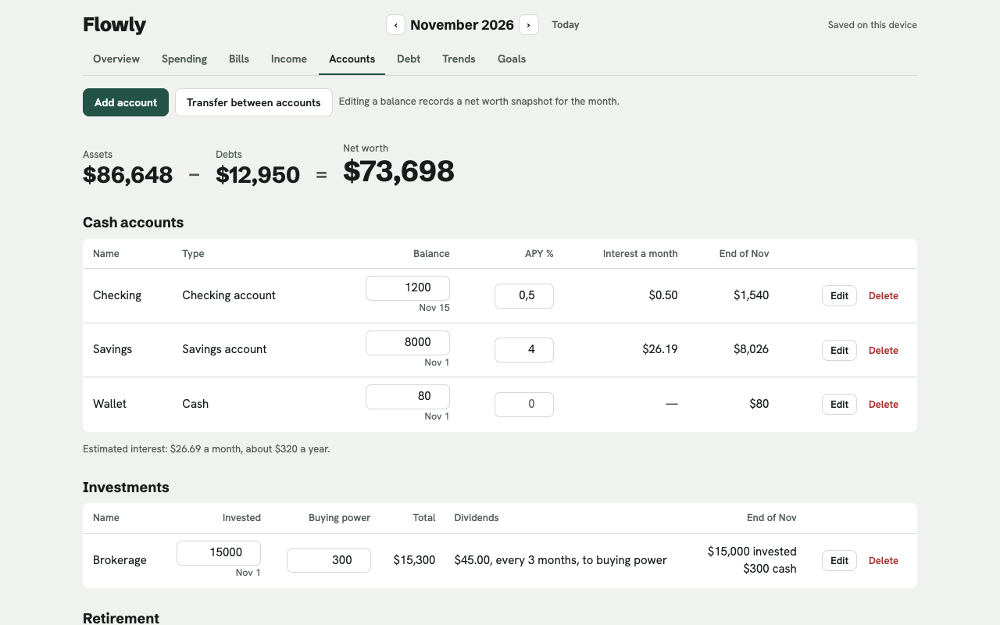</td>
  </tr>
  <tr>
    <td><b>Debt</b><br>Avalanche or snowball: see your debt-free date and what an extra $100 a month saves.<br><br>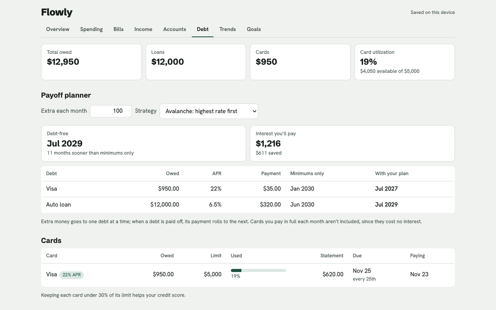</td>
    <td><b>Trends</b><br>Where the money went, by category and tag, month after month.<br><br>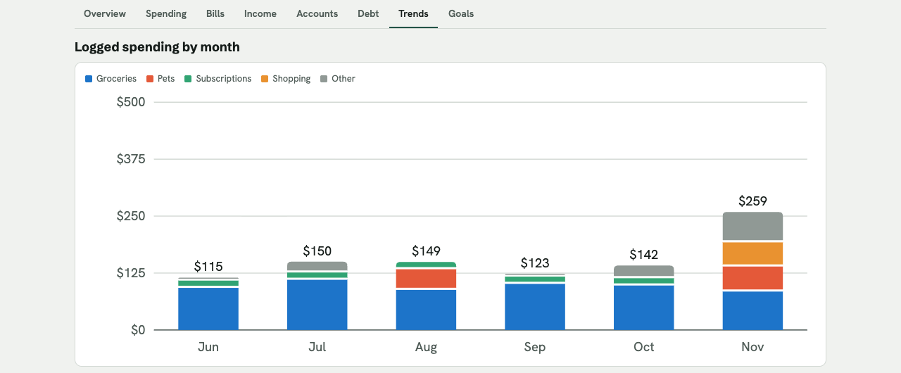</td>
  </tr>
</table>

## Feels at home anywhere

Light and dark follow your system. It fits a phone-width window. The interface comes in English and Russian, with US dollars, euros, Scandinavian kronor and a few other currencies, plus US or Swedish bank holidays.

<table>
  <tr>
    <td width="40%">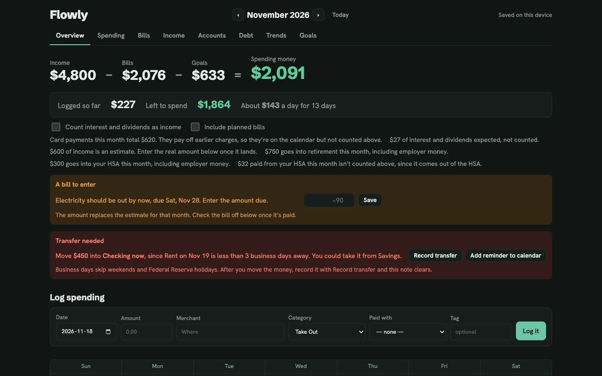</td>
    <td width="40%">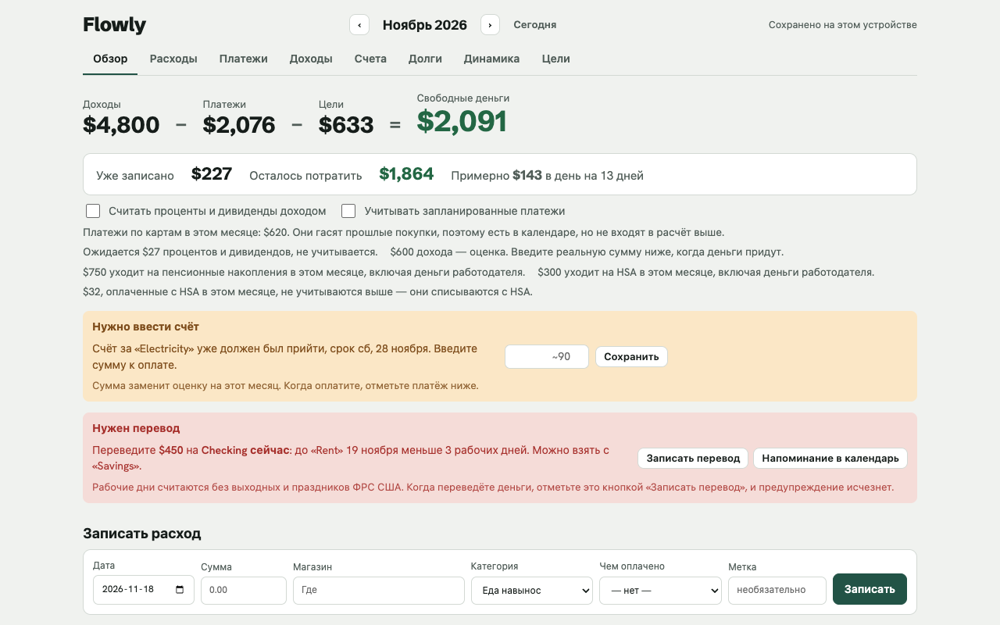</td>
    <td width="10%">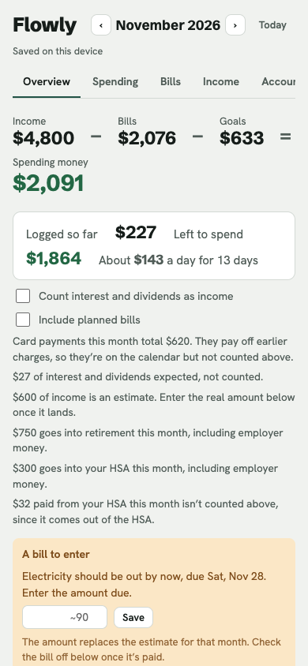</td>
    <td width="10%">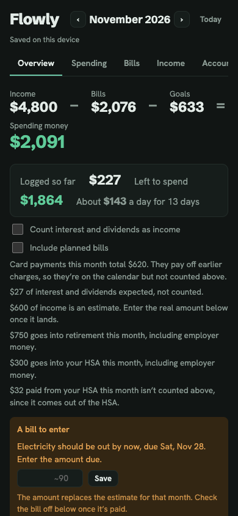</td>
  </tr>
</table>

## An AI that stays home *(optional, Mac)*

Drop in a PDF statement or a screenshot and a model running **on your own Mac** reads the transactions. Ask "what did I spend on food?" and get an answer. You check every transaction before it's imported, and the app does all the math itself: the AI only reads statements and explains the numbers.

1. Install [Ollama](https://ollama.com) and open it.
2. Run `ollama pull gemma4:12b` (about 8 GB, for Macs with 16 GB of memory). On an 8 GB Mac use `gemma3:4b` instead.
3. Open **Spending → Import statement**: it should say the local AI is ready.

For scanned PDFs, import screenshots of the pages instead.

## Install

**Mac app** (Apple Silicon; Intel should work):
```
git clone https://github.com/Tihoxodka/Flowly.git
cd Flowly
bash install.sh
```
It installs Node.js if needed, builds the app, signs it on your Mac and puts it in /Applications. To update: `git pull`, then `bash install.sh` again. Your data is kept.

**Browser** (any computer, needs [Node.js](https://nodejs.org) 22+ once):
```
npm install
npm run build
```
Then open `dist/index.html`. Data stays in that browser, so use the same one each time. No AI features here.

**Coming from Budgeter?** The Mac app copies your data over the first time it starts, and leaves the original where it was. Old backups restore as usual.

## Your data

- **Back up** with **Download backup** at the bottom of the page. **Restore from backup** also moves data between the browser and the Mac app.
- Nothing is sent anywhere. The Mac app blocks all network requests from the page; its only connection is to Ollama on your Mac.
- Data is stored unencrypted (on the Mac, in `~/Library/Application Support/Flowly`). Turn on FileVault, and only restore backups you made yourself.

## Development

Plain JavaScript modules in `src/`, no framework, bundled by esbuild into one page, `dist/index.html`. The Electron wrapper is `main.js`.

```
npm start             # build and run the desktop app
npm test              # unit tests
npm run e2e           # end-to-end tests against saved snapshots of every screen
npm run i18n:check    # interface text missing from the Russian dictionary
npm run typecheck     # JSDoc type check
```

The installer is Mac-only; `npm start` may also work on Windows and Linux, but that isn't tested.

## Credits

Flowly began as a fork of [Budgeter](https://github.com/ReckingBallResearch/Budgeter) by Sean Keehan and has since grown its own way: More languanges, more currencies, Swedish holidays, transfers between accounts, a new module structure. Thanks, Sean.

Fonts: Hanken Grotesk and Schibsted Grotesk (SIL OFL). Licensed under [MIT](LICENSE).
